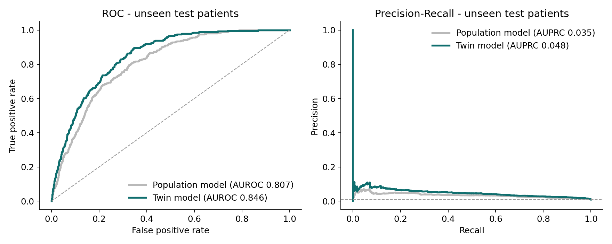
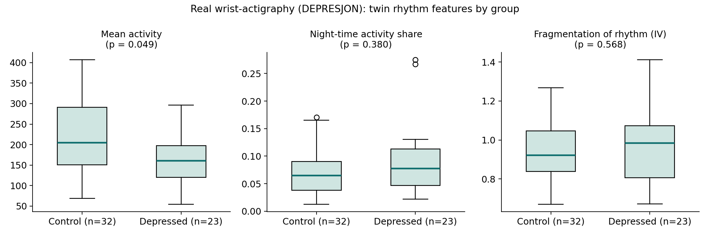

# 🧠 Manas Twin
### A Digital Twin for Early Warning of Depressive Episodes in Indian Students and Young Professionals

> **Manas** (मनस्) means *mind*. Manas Twin keeps a living, personal model of a person's sleep, heart, activity and social rhythm, pairs it with their health record, and raises an **early warning about a week before a depressive episode is likely to begin**, while there is still time to act.

Built for the **Happiest Health "Reimagining and Reforming Healthcare in India" Summit 2026 (Bengaluru), Digital Twin PoC Challenge.**

| | |
|---|---|
| 🎥 **Demo video (15–20 min)** | **[Watch on YouTube (unlisted)](https://youtu.be/REPLACE_WITH_YOUR_LINK)** |
| 🏗️ **Architecture diagram** | [`docs/Manas_Twin_Architecture.pdf`](docs/Manas_Twin_Architecture.pdf) · [`.pptx`](docs/Manas_Twin_Architecture.pptx) |
| 📊 **Presentation** | [`docs/Manas_Twin_Presentation.pdf`](docs/Manas_Twin_Presentation.pdf) · [`.pptx`](docs/Manas_Twin_Presentation.pptx) |
| 🤖 **Model details** | [`MODEL.md`](MODEL.md) |
| 🗂️ **Data card** | [`DATA.md`](DATA.md) |
| 🧪 **Real-data check** | Section 5b below · `reports/depresjon_validation.json` |
| 🧑‍⚕️ **Psychologist evaluation protocol** | [`docs/PSYCHOLOGIST_EVALUATION.md`](docs/PSYCHOLOGIST_EVALUATION.md) |
| ⚖️ **License** | [MIT](LICENSE) |

> ⚠️ **Research prototype on synthetic data. Not a medical device and not a diagnostic tool.**
> If you or someone you know is struggling, call **Tele-MANAS 14416** (Government of India, toll-free, 24×7).

---

## 1. Problem Statement

Depression usually does not arrive overnight. In the days and weeks before an episode, sleep shifts, bedtimes drift later, heart-rate variability falls, people move less and withdraw socially. Today, almost nobody is watching these signals, so care starts **after** someone is already unwell, if it starts at all.

India's own data shows how large the gap is. The NIMHANS **National Mental Health Survey 2015–16** (34,802 people across 12 states) found that nearly **15% of Indian adults need treatment** for one or more mental health conditions, and that the **treatment gap is above 60% for every mental disorder except epilepsy** (ranging from 28% to 83%).

Students and young professionals are particularly exposed: exam seasons, placement pressure, quarter-end crunches, long hours, and migration away from family support. At the same time, they are the group most likely to already wear a smartwatch or fitness band.

**The problem we solve:** *How can we use the data people already generate (wearables and phones), together with their health record, to detect the build-up to a depressive episode early enough to intervene, personalised to each individual's own "normal"?*

Why a one-size-fits-all threshold fails: 6 hours of sleep is normal for one person and a red flag for another. A **digital twin**, a continuously updated virtual model of *one* person, is the natural answer.

## 2. Healthcare Use Case

**Condition:** recurrent depressive episodes (prevalent, chronic, often missed early).
**Target users:** college students (18–24) and young working professionals (23–35) in Indian cities.
**Prediction target:** probability that a depressive episode begins **within the next 7 days**.

**Who uses it and how**

| User | What they get |
|---|---|
| **Student / employee** (with consent) | A daily "you vs. your normal" mirror, gentle nudges when they drift, and a what-if view ("sleeping 1 h more brings your risk back to stable") |
| **Campus counsellor / corporate EAP / doctor** | A risk-ranked caseload, explanations of *why* someone is flagged, PHQ-9 trends and an FHIR-compatible record, so they can reach out **before** a crisis |
| **Institution** (anonymised, aggregated) | Visibility into stress hotspots (e.g. exam weeks) to plan support capacity |

**Example workflow (demo patient MT0441):** an 18-year-old engineering student in Kochi. In end-semester exam season his sleep shortens, bedtime drifts, steps fall and late-night screen time rises, all relative to *his* baseline. The twin moves to **Early warning seven days before the episode starts**. In the simulated "usual care" path, the clinical diagnosis only happened about 19 days *after* onset. With the twin, a counsellor check-in and repeat PHQ-9 could happen in week zero.

**Scope boundary (by design):** Manas Twin predicts depressive-episode onset only. It does **not** assess suicide or self-harm risk. Anything of that kind must always be handled directly by a human professional.

## 3. What makes it a Digital Twin

| Twin capability | How Manas Twin implements it |
|---|---|
| **Virtual replica of one person** | Per-person object combining EHR (demographics, history, PHQ-9, diagnoses, medication) + 8 daily wearable/phone signals |
| **Continuously updated** | Rolling 45-day personal baseline, re-learned every day; live-feed replay in the dashboard |
| **Mirror** | Every signal expressed as deviation from *your own* normal (z-scores + "Twin Drift Index") |
| **Predict** | 7-day episode-onset risk from a gradient-boosted model |
| **Explain** | SHAP values translated into plain language ("sleep 54 min shorter than usual") |
| **Simulate (what-if)** | Change sleep, bedtime, steps, screen time, social contact and re-run the twin |

## 4. Technical Stack

| Layer | Technology |
|---|---|
| Language | Python 3.9+ |
| Data generation | NumPy / pandas, custom physiological-behavioural simulator (`src/simulator.py`) |
| Feature engineering | pandas rolling-window personal baselines (`src/features.py`) |
| ML model | XGBoost gradient-boosted trees (`src/train.py`) |
| Explainability | SHAP TreeExplainer |
| Evaluation | scikit-learn (patient-level split, AUROC, AUPRC, episode-level detection, lead time) |
| Interoperability | HL7 FHIR R4-style JSON bundles (ICD-10, LOINC, ATC codes), ready for ABDM-style exchange (`src/fhir.py`) |
| Dashboard | Streamlit + Plotly, custom light/dark theme (`app/streamlit_app.py`) |
| Real-data hook | Adapter for the public DEPRESJON actigraphy dataset (`src/depresjon_loader.py`) |

## 5. AI/ML Model (summary; full detail in [MODEL.md](MODEL.md))

- **Task:** binary classification. For each person-day, *will a depressive episode start within the next 7 days?*
- **Features (50):** for each of 8 signals, the 7-day average, deviation from personal baseline (7-day and 3-day z-scores) and week-on-week change; an overall Twin Drift Index; bedtime irregularity; wearable non-wear days; EHR context (latest PHQ-9 and its change, prior episodes, family history, medication, comorbidities); known exam / work-crunch calendar.
- **Algorithm:** XGBoost (350 trees, depth 4, learning rate 0.04).
- **Validation:** split **by person** (420 train / 180 test). The test set contains only people the model never saw.
- **Baseline for comparison:** identical model without personal-baseline features (a "population model").

### Results on unseen synthetic patients

| Metric | Twin model | Population model |
|---|---|---|
| AUROC | **0.85** | 0.81 |
| AUPRC (prevalence 0.96%) | **0.048** | 0.035 |
| Episodes flagged before onset | **19 / 40 (48%)** | 16 / 40 (40%) |
| Median warning lead time | **6 days** | 6.5 days |
| False-alert days per 30 quiet days | **1.2** | 1.6 |

**What this shows:** personalising to each person's own baseline improves discrimination and catches more episodes in advance with **~25% fewer false-alert days**. Results are on synthetic data and demonstrate the method, not clinical performance. See limitations below.



### 5b. Real-data check: DEPRESJON wrist-actigraphy

To test whether the twin's rhythm features carry real signal, we ran them on the public **DEPRESJON** dataset (Garcia-Ceja et al., MMSys 2018): minute-level wrist actigraphy from **23 people with depression and 32 controls**, about 13 days each (1,034 complete days). It has no health record and no episode onsets, so it cannot train the early-warning model; it can test the features.

| Question | Result |
|---|---|
| Do rhythm features separate depressed people from controls? | **AUROC 0.82** (95% CI 0.71–0.92), leave-one-person-out logistic regression; 65% of depressed people identified at 80% specificity |
| Which features differ? | Lower mean activity (p = 0.049), more minutes at rest (p = 0.075), **less day-to-day variability** (p = 0.035) in the depressed group, consistent with the digital-phenotyping literature |
| Does the personal baseline add information *here*? | No, and it shouldn't: DEPRESJON has no within-person onsets to detect. The between-person signal lives in raw levels; the personal baseline is the layer for within-person change, which needs longitudinal data |
| Do features track MADRS severity? | Not significantly with n = 23 (rho between −0.3 and 0.2) |

Reproduce: download DEPRESJON to `data/depresjon/` and run `python -m src.validate_depresjon`. The dataset is not redistributed in this repository.



## 6. Quick start

```bash
git clone https://github.com/<your-username>/manas-twin.git
cd manas-twin
python -m venv .venv && source .venv/bin/activate    # Windows: .venv\Scripts\activate
pip install -r requirements.txt

# Option A - use the data and model already in the repo
streamlit run app/streamlit_app.py

# Option B - regenerate everything from scratch (~2 minutes)
python -m src.simulator      # synthetic cohort  -> data/
python -m src.train          # train + evaluate  -> models/, reports/
python -m src.fhir MT0441 140   # sample FHIR bundle -> data/fhir_samples/
streamlit run app/streamlit_app.py
```

**Dashboard views:** 📖 Story (guided 6-step walkthrough, start here) · 🧠 Twin · 🔮 What-if · 🩺 Clinician · 📡 Live · 📊 Performance · ℹ️ About.
Toggle **🌙 Dark mode** in the sidebar.

**Designed so anyone can read it:** each person's state is shown as **mind-weather** (☀️ Clear skies / ⛅ Clouds gathering / ⛈️ Storm likely), with a plain-English summary ("sleeping 54 min less than usual…"), a suggested next step, and body-rhythm cards that compare the last week with the person's own normal. Display names (e.g. "Arjun") are invented, like the data.

**Best demo people:** `MT0441` "Arjun" (student, exam season) and `MT0156` "Rohan" (IT professional, quarter-end).

**For clinician testing:** the app opens on **📘 Guide**, a 15-minute protocol with 5 tasks written for psychologists and counsellors, and **📝 Feedback** collects structured ratings and comments into `feedback/responses.csv` (organiser view behind a passcode). **➕ Enrol a demo client** on the Clinician tab generates a new synthetic client and builds their twin live. See `docs/PSYCHOLOGIST_EVALUATION.md`. For remote testing, deploy to Streamlit Community Cloud and turn on the Google Sheets feedback sync (`docs/GOOGLE_SHEETS_SYNC.md`).

**One-command run with Docker:** `docker compose up`, then open http://localhost:8501.

## 7. Repository structure

```
manas-twin/
├── app/streamlit_app.py        # interactive dashboard (story mode + 6 views, dark/light)
├── .streamlit/config.toml      # base theme
├── src/
│   ├── config.py               # settings, signal definitions, helpline
│   ├── simulator.py            # synthetic cohort: wearables + EHR + ground-truth episodes
│   ├── features.py             # personal-baseline (twin) and population features, labels
│   ├── train.py                # training, patient-level evaluation, SHAP, figures
│   ├── twin.py                 # DigitalTwin class: state / risk / explain / what_if
│   ├── fhir.py                 # FHIR R4-style export
│   ├── depresjon_loader.py     # real-data adapter
│   ├── validate_depresjon.py   # real-data check (AUROC, group differences)
│   └── feedback.py             # tester feedback store
├── data/                       # synthetic data, risk scores, FHIR samples, demo patients
├── models/                     # trained XGBoost models + metadata
├── reports/                    # metrics.json, SHAP importance, figures
├── docs/                       # architecture diagram, presentation, demo script, psychologist evaluation protocol
├── Dockerfile · docker-compose.yml
├── MODEL.md  DATA.md  LICENSE  requirements.txt
```

## 8. Limitations (read before judging the numbers)

1. **Synthetic data.** No public dataset links daily wearables to longitudinal health records for Indian young adults, so the cohort is simulated from published digital-phenotyping patterns. Real-world performance will differ.
2. **Moderate sensitivity.** About half of episodes are flagged in advance. This is a screening aid to prompt a human check-in, not a detector to rely on alone.
3. **What-if is associative.** It shows how the model's estimate responds, not a proven causal effect of behaviour change.
4. **Device and access bias.** Wearable ownership skews urban and higher-income. Deployment must not widen inequity (phone-only signals are a planned fallback).

## 9. Responsible AI, privacy and safety

- **Consent-first** design aligned with India's **Digital Personal Data Protection Act 2023** and **ABDM** consent flows; revocable at any time.
- **Data minimisation and pseudonymisation**: no names, IDs only; aggregated views for institutions.
- **Human in the loop**: the twin alerts; a counsellor or clinician decides.
- **No suicide/self-harm prediction**; crisis signposting to **Tele-MANAS 14416** is shown in-app.
- **Explainability by default**: every alert comes with its reasons.

## 10. Roadmap

1. Real-data check on DEPRESJON done (section 5b). Next: structured evaluation with 30 psychologists (protocol in `docs/`), then a consented longitudinal pilot with a university wellness centre.
2. Live ingestion from Google Health Connect / Apple HealthKit; ABDM-linked records via FHIR.
3. Personalised forecasting models (per-person fine-tuning, sequence models) and causal what-if.
4. Clinician-co-designed alert pathways, multilingual nudges, phone-only mode.

## 11. Team
| TEAM KABIL | SYMBIOSIS CENTRE FOR INFORMATION TECHNOLOGY (SCIT), SIU (Deemed University) |

## 12. License

Code released under the [MIT License](LICENSE). All data in this repository is synthetic and generated by this code. The DEPRESJON dataset is **not** redistributed; see its own terms if you download it.
